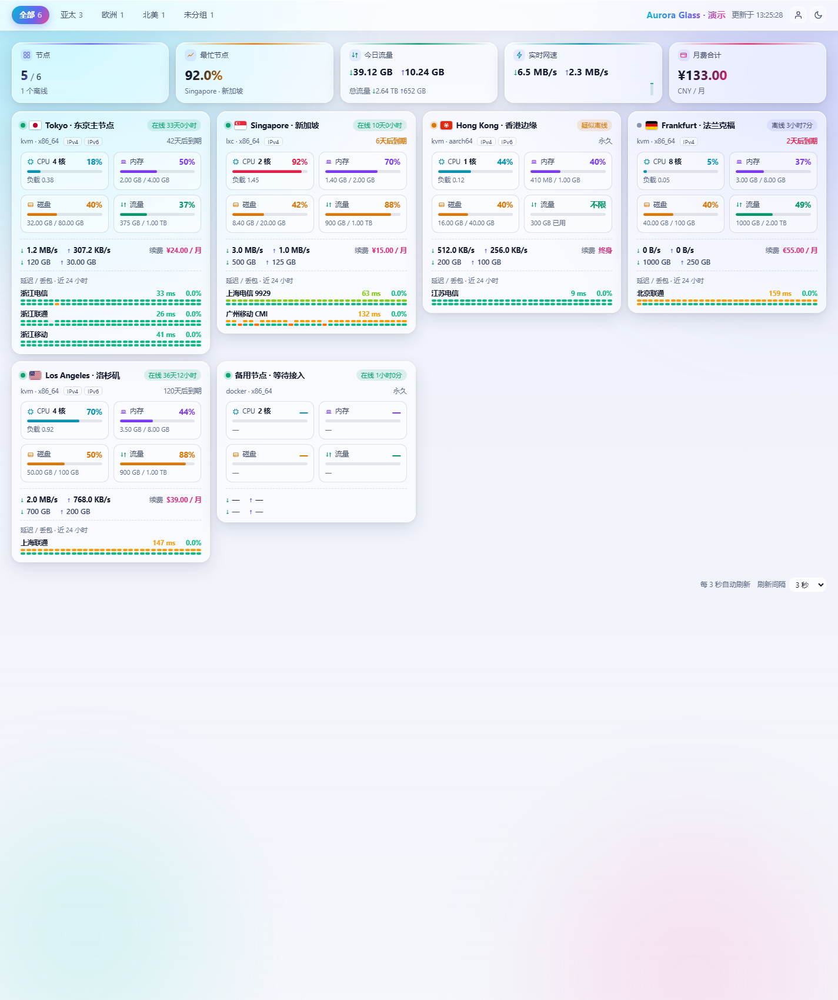

# XBProbe-Theme · 小白探针主题仓库

[XB-Probe（小白探针）](https://github.com/koyoca/XB-Probe) 的外部公开看板主题集合。
**一个目录一个主题**，每个主题都能单独打包成 zip，在后台「系统 → 主题」上传安装/更新。

## 主题列表

| 主题 | 版本 | 说明 | 下载 |
|---|---|---|---|
| [`aurora-glass`](aurora-glass/) · 极光琉璃 | 1.1.0 | 极光渐变背景 + 毛玻璃卡片；2×2 指标格节点卡片、彩色延迟点阵、在线情况时间线、Canvas 曲线 | [aurora-glass.zip](https://github.com/koyoca/XBProbe-Theme/releases/download/aurora-glass-v1.1.0/aurora-glass.zip) |



## 目录约定

```
XBProbe-Theme/
├── aurora-glass/          # 一个主题一个目录，目录名 = 主题名 = zip 名
│   ├── theme.json         # 必需：主题元数据（name / version / api_version / entry）
│   ├── index.html         # 必需：入口（entry 指向的文件）
│   ├── style.css          # 主题静态资源（名字随意，由 index.html 引用）
│   ├── app.js
│   ├── favicon.svg
│   ├── preview.png        # 预览图（仓库展示用，不强制）
│   └── README.md          # 该主题自己的说明
├── scripts/build-themes.py  # 本地打包：每个主题 → dist/<主题名>.zip
├── .github/workflows/release.yml  # 打 tag 后自动校验 + 打包 + 发布 Release
└── dist/                  # 本地打包产物（已 gitignore）
```

要求：

- 主题目录名**必须**与 `theme.json` 里的显示名分开看——目录名是主题标识
  （后台列表与 zip 文件名都用它），`name` 只是展示文案。
- 主题目录里不要放 `.git`、`dist` 或临时文件：打包会原样带走。
- 主题必须遵守平台前端约束：CSP `default-src 'self'`（无内联脚本/样式、无外链）、
  只调用 `/api/public/v1/*`、不可信字符串一律 `textContent`。

## 安装 / 更新

推荐**后台上传主题包**（XB-Probe 0.3.1 起）：

1. 从 [Releases](https://github.com/koyoca/XBProbe-Theme/releases) 下载对应主题的 zip，
   或本地运行 `python3 scripts/build-themes.py` 生成；
2. 管理后台 → **系统 → 主题 → 上传主题包**，选择 zip；
3. 勾选「安装后立即启用」可直接切换。**zip 文件名就是主题名**，
   同名主题会被整目录替换——这就是更新方式。

也可以手工拷贝到 Master 的 `themes_dir`（默认 `/var/lib/xb-probe-master/themes`）：

```bash
git clone https://github.com/koyoca/XBProbe-Theme.git /tmp/xbt
sudo cp -r /tmp/xbt/aurora-glass /var/lib/xb-probe-master/themes/aurora-glass
sudo chown -R probe:probe /var/lib/xb-probe-master/themes/aurora-glass
sudo systemctl restart xb-probe-master
```

## 发布一个主题的新版本

版本号写在主题自己的 `theme.json` 里，tag 约定为 **`<主题名>-v<版本>`**：

```bash
# 1) 改主题内容与 aurora-glass/theme.json 的 version（例如 1.2.0）
# 2) 打 tag 并推送（CI 会校验 tag 与 theme.json 一致 → 打包 → 创建 Release）
git tag aurora-glass-v1.2.0
git push origin aurora-glass-v1.2.0
```

CI 产物：Release 里附 `aurora-glass.zip`（zip 根目录就是 `theme.json`，
可直接在后台安装）。tag 与 `theme.json` 的 `version` 不一致会直接失败，
避免"发了新版本号但包还是旧的"。

## 本地打包

```bash
python3 scripts/build-themes.py              # 打包全部主题
python3 scripts/build-themes.py --only aurora-glass
# 产物：dist/aurora-glass.zip
```

## 新增一个主题

1. 建目录 `my-theme/`（目录名即主题名，建议小写 + 连字符）；
2. 放入 `theme.json`、`index.html` 与该主题的全部静态资源；
3. 参考 [`aurora-glass/README.md`](aurora-glass/README.md) 写主题说明与 `preview.png`；
4. 在本文件的主题列表里加一行；
5. 发版：`git tag my-theme-v1.0.0 && git push origin my-theme-v1.0.0`。

## 许可

各主题的许可见其目录内的说明；仓库脚本与工作流可自由使用。
